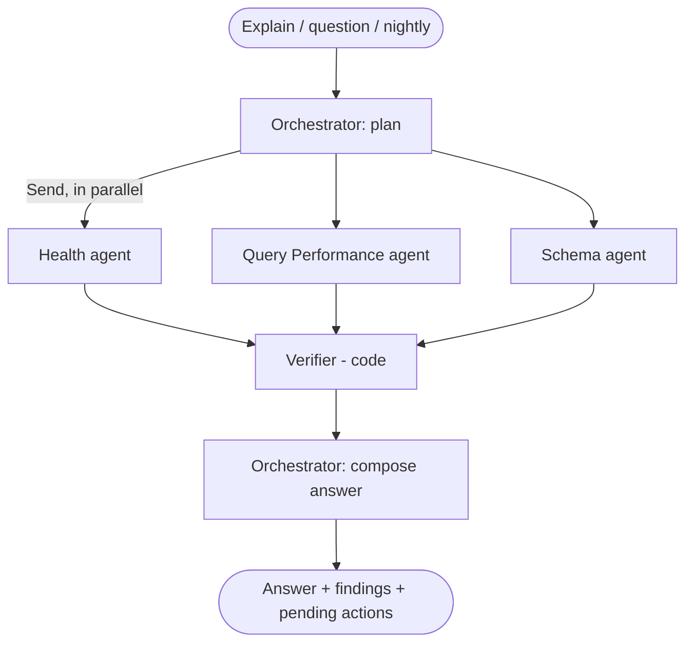
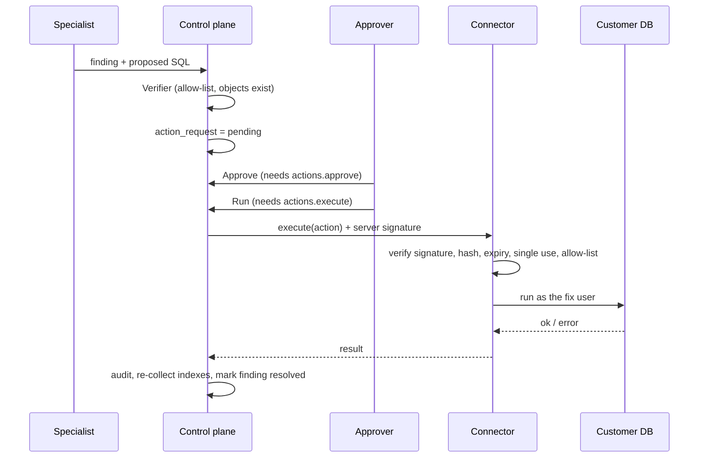

# 08 — AI Agents (Phase 5)

How the AI layer works: which agents exist, what they may see and do, how a fix goes from
an AI suggestion to a change on the customer's database, and the order we build it in.
Decisions behind it: [ADR 0006](adr/0006-ai-orchestration.md). Safety rules it must keep:
[ADR 0005](adr/0005-read-only-by-default.md).

## What the AI does

| Feature | Trigger | Output |
|---|---|---|
| **Explain** | "Explain" on a problem in *Needs attention* | Plain-language cause, impact and fix for that one problem |
| **Ask AI** | A question in the chat panel on a server page | Answer with the evidence it used, plus suggested fixes |
| **Suggest fixes** | Any run that finds something fixable | Pending *actions* (exact SQL) that a person approves |
| **Reports** | Nightly per server, or "Generate now" | Health report: what changed, top problems, suggested fixes |

All four run the same agent graph; only the entry point and the final format differ.

## Non-negotiable rules

1. **The AI never touches a database.** It calls named tools; the control plane runs them
   through the connector. The datasource is fixed by the server for the run — the model
   cannot choose or change it.
2. **The AI sees statistics and structure only, never rows.** Tool results are health
   numbers, table/index metadata and *normalized* query text (MySQL digests and
   `pg_stat_statements` replace literal values with `?` / `$1`).
3. **The AI cannot write.** It can only *propose* an action. Code (not the model) checks it,
   a person approves it, and the connector verifies a server signature before running it.
4. **Every claim needs evidence.** Findings must cite facts returned by tools; findings that
   cite nothing, or cite facts that do not exist, are dropped before anyone sees them.
5. **The product works without AI.** If Groq is down or the tenant is over its limit, the
   dashboard and collectors keep working; AI features show "unavailable".

## Agents

| Agent | Kind | Tools | Owns |
|---|---|---|---|
| **Orchestrator** | LLM | none | Plans which specialists to ask; writes the final answer |
| **Health & Monitoring** | LLM | `health`, `locks` | Connections, cache, uptime, lock waits |
| **Query Performance** | LLM | `slow_queries`, `table_stats`, `indexes` | Slow/full-scan queries, missing indexes |
| **Schema** | LLM | `table_stats`, `indexes`, `list_databases` | Primary keys, duplicate/unused indexes, big tables |
| **Verifier** | code | — | Evidence check, SQL allow-list, object existence |
| **Ops Executor** | code | — | Runs *approved* actions through the connector |

Specialists may attach a proposed action to a finding. There is no separate "fix" agent:
the specialist that found the problem knows the fix best, and the Verifier checks it.

## The graph (LangGraph)



- **plan** — structured output: which specialists to run (1–3) and a focused sub-question
  for each. *Explain* skips planning: the problem's category picks the specialist.
- **specialists** — each is a small tool-calling loop limited to its own tools, at most
  **4 tool calls**, returning `Finding[]` as strict JSON.
- **verify** — pure Python, see below.
- **compose** — turns verified findings into the reply for the entry point (chat answer,
  explanation, or report sections).

### Run state

```python
class RunState(TypedDict):
    run_id: UUID
    tenant_id: UUID
    datasource_id: UUID          # set by the server, never by the model
    engine: Literal["mysql", "postgres"]
    kind: Literal["explain", "chat", "report"]
    question: str
    history: list[Message]       # last 10 chat messages, chat only
    plan: list[Task]
    facts: dict[str, Fact]       # "H1", "T3", "I7" … every number a tool returned
    findings: list[Finding]
    answer: str
```

### Facts and evidence

Each tool result is flattened into numbered **facts** before the model sees it, for example
`T3 = {table: "hrm.attendance", rows: 200000, full_scans: 412, has_pk: true}`. Prefixes:
`H` health, `T` tables, `I` indexes, `Q` queries, `L` locks. A finding must list the fact IDs
it relies on:

```json
{
  "severity": "high",
  "category": "missing_index",
  "title": "attendance is read in full 412 times",
  "explanation": "Every lookup by employee and day reads all 200,000 rows …",
  "evidence": ["T3", "Q2"],
  "action": {
    "statement": "CREATE INDEX idx_attendance_emp_day ON hrm.attendance (emp_id, day)",
    "reason": "Lets Q2 read a few rows instead of the whole table",
    "risk": "low"
  }
}
```

### Verifier (code)

A finding survives only if:

1. every evidence ID exists in `facts`;
2. any table, column or index it names exists in the latest snapshot;
3. its action, if any, passes the **action allow-list**: exactly one statement, parsed with
   `sqlglot`, and one of:

| Engine | Allowed |
|---|---|
| MySQL / MariaDB | `CREATE INDEX`, `DROP INDEX`, `ANALYZE TABLE`, `OPTIMIZE TABLE` |
| PostgreSQL | `CREATE INDEX CONCURRENTLY`, `DROP INDEX CONCURRENTLY`, `ANALYZE`, `VACUUM (ANALYZE)`, `REINDEX INDEX CONCURRENTLY` |

Anything else (`UPDATE`, `DELETE`, `DROP TABLE`, `TRUNCATE`, `GRANT`, multi-statement …) is
removed from the finding; the finding itself stays as advice. The connector runs the same
check again before executing (rule 3).

## Tools

Tools are thin wrappers over the collectors that already exist. A tool reuses the latest
snapshot when it is fresh (≤ 5 minutes for AI runs) and otherwise asks the connector to
collect, so the AI and the dashboard always agree on the numbers.

| Tool | Source | Status |
|---|---|---|
| `health` | collector | exists (4.3b) |
| `table_stats` | collector | exists (4.3b) |
| `indexes` | collector | exists (4.3b) |
| `list_databases` | datasource catalog | exists (4.3a) |
| `slow_queries` | MySQL `performance_schema.events_statements_summary_by_digest`; Postgres `pg_stat_statements` (answers *not available* with the reason if missing) | 5.1 |
| `locks` | MySQL `performance_schema.data_lock_waits` + `INNODB_TRX`; Postgres `pg_stat_activity` + `pg_blocking_pids()` | 5.1 |
| `find_tables` | the `table_index` collector (every table's name, rows, size), searched in ZipZy | 5.1 |

Tool output is capped (top 20 queries, 50 lock rows, 25 search results) and passed to the
model as JSON data.
Names that come from the customer database are data, never instructions; the system prompt
says so, and rules 1–3 mean an injected instruction has nothing dangerous to call.

## Finding the right table

A server can have thousands of tables (`attendance_2024_01` … one per month, per branch). The
model never receives the full list. `find_tables(question, schema?, period?)` searches the
latest `table_index` snapshot inside ZipZy (`app/services/table_search.py`):

- **Families:** tables that differ only by a trailing date or number are one result
  (`hrm.attendance_*`, 36 tables, 2024-01 … 2026-12); a dated member carries its period.
- **Matching:** words of the question against words of schema and table names — exact,
  prefix or small typo; words that match no name ("lowest", "employee who …") and time words
  are ignored. Ranked by match, then size.
- **Period:** with `period="2026-11"`, a family lists that month's table and ranks above an
  equal match without one; a missing month returns the nearest earlier table with a note.
- **Ambiguity:** when the top two are about equally good, the result is marked `ambiguous`
  and the agent **asks the person** ("hrm.attendance_* or payroll.attendance?") with the
  options as buttons — it never guesses.
- **Context:** the chosen table is kept in the conversation, so "add an index to it" needs no
  new search; *Explain* passes the exact table and skips the search.

`table_index` lists up to 50,000 tables (biggest first, within one 3 MB message) and is
refreshed at most every 10 minutes; only its latest snapshot is kept.

## From suggestion to change (actions)



- **Who can do what** (existing permissions, no new ones): asking and explaining need
  `metadata.read` / `findings.read`; an AI suggestion becomes an action request on behalf of
  the user who asked, so it needs `actions.request` — without it the fix is shown as text
  only. Approving needs `actions.approve`, running needs `actions.execute`.
- **Production environments:** the approver must be a different person from the requester.
  Nightly-report suggestions are requested by `system`.
- **Signed approval:** the control plane signs
  `{action_id, datasource, sha256(statement), expires_at (15 min), nonce}` with its own
  Ed25519 key. The connector learns that public key at enrolment and keeps used nonces, so an
  approval cannot be replayed or reused for different SQL.
- **Fix user:** the connector runs approved actions with a separate database user that has
  only index and maintenance rights. It is optional: a connector without one reports
  `can_execute = false` and the dashboard shows "Copy SQL" instead of "Run".
- **Statuses:** `pending → approved → running → done | failed`, or `rejected` / `expired`
  (not run within 24 h of approval).

## Data model (new tables)

| Table | Purpose |
|---|---|
| `agent_runs` | One row per run: kind, datasource, status, model, tokens in/out, latency, error, step trace (JSONB) |
| `findings` | Verified findings: run, datasource, severity, category, title, explanation, evidence, `fingerprint` (dedupe across runs), status `open / resolved / dismissed` |
| `ai_conversations`, `ai_messages` | Chat history per datasource and user |
| `action_requests` | Proposed change: statement, hash, kind, reason, risk, status, requested by, source finding |
| `action_approvals` | Who approved or rejected, when, and the signed approval issued |
| `ai_usage_daily` | Per-tenant tokens and runs per day, for limits |

All are tenant-scoped (RLS like every other table) and documented in
[04 Data model](04-data-model.md) by the PR that adds them.

## API

| Method & path | What |
|---|---|
| `POST /v1/datasources/{id}/ai/runs` | Start a run (`explain` with a problem key, or `chat` with a message) → `202` + run id |
| `GET /v1/ai/runs/{run_id}` | Status, steps so far ("Checking indexes…"), answer, findings |
| `GET /v1/datasources/{id}/ai/conversations` | Chat history |
| `GET /v1/datasources/{id}/findings` | Open findings |
| `GET /v1/datasources/{id}/actions` | Actions by status |
| `POST /v1/actions/{id}/approve` · `/reject` · `/execute` | Approval workflow |
| `GET /v1/datasources/{id}/reports` · `POST …/reports` | Reports, generate now |

The dashboard polls a running run every second; it works unchanged through the demo tunnel.

## Model and limits

| Setting | Default |
|---|---|
| `GROQ_API_KEY` | required for AI features; never logged, never sent to the browser |
| `AI_MODEL` | `openai/gpt-oss-120b` (strict JSON-schema output) |
| `AI_FALLBACK_MODEL` | `openai/gpt-oss-20b`, used on rate limit or server error |
| `AI_TIMEOUT_S` | 30 per model call, 90 per run |
| `AI_DAILY_RUNS` / `AI_DAILY_TOKENS` | 50 runs / 200,000 tokens per tenant |

Runs execute in the API process as background tasks (one API instance today). Nightly
reports use an in-process scheduler at 02:00 IST; it moves to a worker if we scale out.

## Dashboard

- **Server page → Needs attention:** an *Explain* button on each problem.
- **Server page → Ask AI** panel: chat with progress steps and evidence chips (`T3`, `Q2`)
  that open the underlying numbers.
- **Server page → Queries** tab: slow queries and lock waits (5.1).
- **Server page → Fixes** tab: actions by status, with Approve / Reject / Run or Copy SQL.
- **Reports** page per server.

## Testing

- Unit tests run the graph with a **scripted fake model** (no network): routing, the
  4-call limit, evidence checking, and every allow-list case including injection attempts.
- Connector tests for `slow_queries`, `locks` and action execution against real MySQL and
  PostgreSQL in CI, as for the existing collectors.
- A small set of recorded scenarios (missing index, duplicate index, no primary key, lock
  wait) checks that a real model run produces the expected finding; run by hand, not in CI.

## Build order

| PR | Scope |
|---|---|
| **5.1** ✅ | Collectors `slow_queries`, `locks`, `table_index` (connector 0.6.0), migration 0006, table search (`find_tables`), Queries tab — everything the agents read, with no model involved yet |
| **5.2** | Groq client with fallback, AI settings, tool layer and facts, LangGraph orchestrator + specialists + verifier, `agent_runs` + `findings` + conversations + `ai_usage_daily`, Explain button and Ask AI panel |
| **5.3** | `action_requests` + `action_approvals`, server signing key, connector executor and fix user, Fixes tab |
| **5.4** | Nightly reports, Reports page, usage limits shown in Settings |
| **5.5** | *Ask your data* (below) |

## 5.5 — Ask your data (planned)

Questions about rows ("show the attendance of the employee with the lowest attendance") need
the data itself. They get their own mode, built so that **the model writes the query but never
sees the results**:

```
question → find_tables (table + period) → model reads column names only → ONE SELECT
         → Verifier (code) → person sees the SQL and clicks Run
         → connector runs it as the data reader user → results go only to the person's screen
```

- **ZipZy tenant:** fixed by the server for the run (as for every tool); RLS in the metadata DB.
- **The customer's own tenant column** (e.g. `company_id`): when a table has one, the
  Verifier rejects a query without a filter on it; the person picks the value.
- **Size:** at most 12 tables per query, `LIMIT 100`, 5 s timeout, read-only session.
- **Who may run it:** `data.read` in that environment (05 RBAC), **and** the customer's own
  grants to a separate *data reader* database user (they decide which tables or views), **and**
  columns marked hidden in `connector.yaml` are blanked before results leave their network.
- **Not checked by ZipZy:** the customer's application rules (e.g. a manager sees only their
  team); they enforce those with a view granted to the data reader user.
